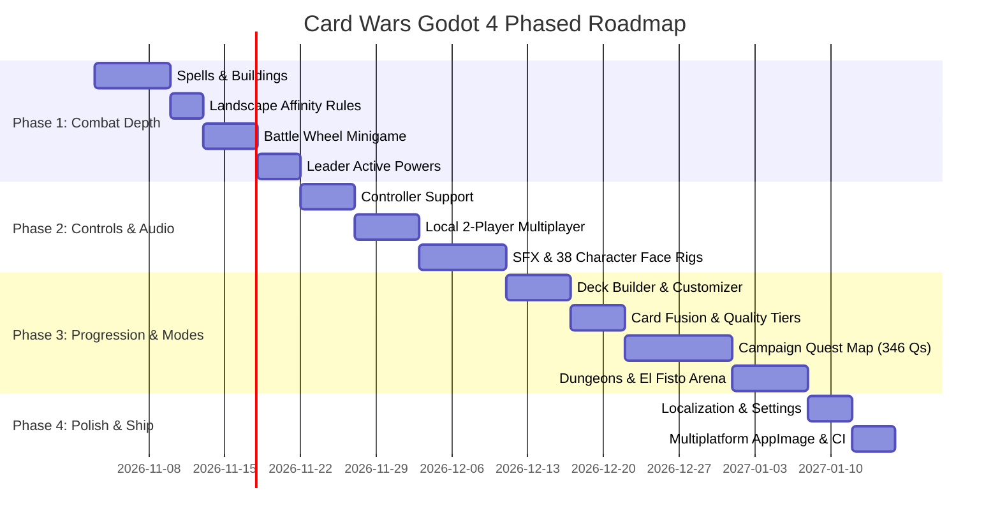

# Card Wars (Godot 4 PC Remake) - Master Backlog & Architecture Specification

An exhaustive technical backlog and architectural blueprint for the open-source Godot 4 remake of *Adventure Time: Card Wars*, detailing all 1,380+ C# scripts, 240+ managers, 340+ quests, 38 animated character rigs, and the complete gameplay engine.

---

## 🧭 Executive Summary & Status

- **Engine Target**: Godot 4.7+ (GL Compatibility / Forward+, GDScript).
- **Core Architecture**: Data-driven ECS/Node architecture loading original JSON blueprints and textures directly from disk.
- **Current Milestone (Milestone 0: Prototype Foundation - Complete)**:
  - [x] Blueprints Engine (`Database.gd`): 416 cards, 288 textures, 1,127 localizations loaded dynamically.
  - [x] 4-Lane Combat Proof-of-Concept: Player vs. Opponent lanes, MP ramp, basic Floop triggers, lane attacks, and direct Hero damage.
  - [x] Main Menu & Card Compendium Browser.
  - [x] Verified zero-error headless compilation and test runs.

---

## 📑 Epics & Comprehensive Task Breakdown

```
├── Epic 1: Pre-Battle Setup & Flow (RPS, Landscapes, Matchups)
├── Epic 2: Core Battlefield & Combat Resolver Engine
├── Epic 3: Complete Card Ability & Floop Script Library (317+ Scripts)
├── Epic 4: 38 Animated Character Face Rigs & Audio System
├── Epic 5: Controller Support & Local Multiplayer
├── Epic 6: Deck Building, Fusion & Inventory
├── Epic 7: Campaign, Quests & Game Modes (346 Quests, Fionna & Cake, Dungeons, El Fisto)
├── Epic 8: Economy, Chests & Progression
└── Epic 9: UI, Localization, Settings & Multiplatform CI/CD
```

---

### Epic 1: Pre-Battle Setup & Match Flow

*Reference Unity Scripts: `RPSMatrix.cs`, `RPSManager.cs`, `LandscapePreviewController.cs`, `ManualLandscapeScript.cs`, `CWBattleIntroController.cs`*

- [ ] **Task 1.1: Rock-Paper-Scissors (RPS) Turn Decider**
  - [ ] Implement the opening minigame before turn 1 (`RPSMatrix.cs`).
  - [ ] Player picks Rock, Paper, or Scissors; Opponent AI chooses.
  - [ ] Winner chooses whether to play **First** or **Second** (with tie re-rolls).
  - [ ] Setting option: "Auto-roll RPS" or "Skip RPS" for fast battles.
- [ ] **Task 1.2: Landscape Placement Phase**
  - [ ] Before placing cards, players set or confirm 4 landscapes across their 4 lanes (`LandscapePreviewController.cs`).
  - [ ] Landscape types: **Plains**, **Corn**, **Cotton**, **Sand**, **Swamp**, and **Candy** (Fionna & Cake).
  - [ ] Animated 3D/2D landscape drop sequence into the 4 lane slots.
- [ ] **Task 1.3: Matchup Intro Sequence**
  - [ ] Display Hero matchup overlay: Player Hero portrait vs. Opponent Hero portrait (`CWBattleIntroController.cs`).
  - [ ] Display starting HP, Leader names, and play intro character VO line (e.g. Finn vs. Jake banter).

---

### Epic 2: Core Battlefield & Combat Resolver Engine

*Reference Unity Scripts: `BattlePhaseManager.cs`, `BattleResolver.cs`, `AttackResolver.cs`, `BattleWheelController.cs`, `BuildingScript.cs`, `SpellResolver.cs`, `DiscardPileController.cs`*

- [ ] **Task 2.1: Phase State Machine (`BattlePhaseManager.gd`)**
  - [ ] Strict phase transitions:
    1. `START_TURN`: Draw 1 card, increment Max MP (+1 up to 10), reset unflooped states, tick building/leader cooldowns.
    2. `ACTION_PHASE`: Free play of Creatures, Spells, Buildings, and activating Floop abilities.
    3. `BATTLE_WHEEL_PHASE`: Triggered during combat for timing attacks and blocks.
    4. `COMBAT_RESOLUTION`: Lane-by-lane clash (Lane 0 $\rightarrow$ Lane 3).
    5. `END_TURN`: Discard resolution, tick passive effects, pass turn to next player.
- [ ] **Task 2.2: Spell Cards System**
  - [ ] Implement spell card play from hand:
    - **Untargeted Spells**: Board-wide effects (e.g. *Grain Storm*, *Hot Dog Rain*).
    - **Targeted Spells**: Draggable target reticle onto friendly/enemy creature or lane (e.g. *Scroll of Bad Breath*, *Teleport*).
  - [ ] Send resolved spells to Graveyard / Discard Pile (`DiscardPileController.cs`).
- [ ] **Task 2.3: Building Cards System**
  - [ ] Dedicated rear building slot behind creature slots in each of the 4 lanes.
  - [ ] Continuous lane auras (e.g., `FruitCakeBuilding`: creature in lane gains +DEF; `RedDome`: creature gains +ATK).
  - [ ] Building targeting and destruction mechanics (`DestroyBuildingLane.cs`, `MoveBuildingSelf.cs`).
- [ ] **Task 2.4: Landscape Affinity Enforcer**
  - [ ] Creature summon validation: Corn creature requires Corn lane, Plains requires Plains, etc.
  - [ ] Universal creatures (`Faction == "Universal"`) playable on any landscape.
  - [ ] Visual lane highlight: green glow if compatible, red X if mismatched.
- [ ] **Task 2.5: The Battle Wheel (Roulette Minigame)**
  - [ ] Spinning wheel UI modal (`BattleWheel.tscn`):
    - Reads `Ring_P1_HitAreaRange`, `Ring_P1_CritAreaRange`, and rotation speed from `db_Leaders.json`.
    - **Critical Hit**: 2x damage multiplier + screen shake.
    - **Hit**: 100% normal damage.
    - **Miss / Block**: 0 damage dealt or incoming attack completely shielded.
  - [ ] Configurable in Settings: Manual Wheel, Auto-Hit, or Instant Skip.
- [ ] **Task 2.6: Leader Powers & Cooldown Trackers**
  - [ ] Active Leader power button on battlefield HUD.
  - [ ] Turn cooldown counter (e.g., 3 turns cooldown).
  - [ ] Leader effects: Finn (+2 MP), Jake (+3 ATK to Corn creatures), PB (Heal all creatures), Marceline (+2 ATK to all), BMO (Extra action points), Ice King (Freeze lane).
- [ ] **Task 2.7: Advanced Combat Resolution**
  - [ ] Overkill direct damage calculations.
  - [ ] Defense armor vs. direct piercing damage.
  - [ ] Lane counter-attacks when specified by creature abilities.

---

### Epic 3: Complete Ability & Floop Engine (317+ Combat Scripts)

*Reference Unity Scripts: `Assets/Scripts/Assembly-CSharp/` (317 scripts matching `ATKBonus*`, `DEFBonus*`, `ActionOnFloop*`, `Heal*`, `Damage*`, `Block*`)*

- [ ] **Task 3.1: Ability Trigger Event Dispatcher**
  - [ ] Implement event listeners for all 6 core card trigger events:
    1. `ON_FLOOP`: Activated manually by player spending Floop MP.
    2. `ON_DEATH`: Triggers when creature DEF drops to 0 (`DamageHeroOnDeath.cs`, `HealHeroOnDeath.cs`).
    3. `ON_TURN_START`: Passive beginning-of-turn effects (`StartTurnHealCreature.cs`).
    4. `ON_TURN_END`: End-of-turn status checks (`EndTurnDEFBonus.cs`).
    5. `ON_SUMMON`: Triggers upon entering the lane (`SpawnCreatureBonus.cs`).
    6. `STATIC_AURA`: Continuous passive modifiers based on neighbors (`AdjacentATKBonus.cs`, `AdjacentDEFBonus.cs`).
- [ ] **Task 3.2: Stat Manipulation Script Library**
  - [ ] `ATKBonusAll`, `DEFBonusAll`, `ATKDEFBonusBuilding`.
  - [ ] `LowerATKTarget`, `BonusDEFTarget`, `LowerATKBonusATK`.
  - [ ] `SwapATKDEF`: Swaps creature Attack and Defense values.
  - [ ] `ATKPenaltyFaction`: Decreases opponent stats based on faction.
- [ ] **Task 3.3: Board Control & Manipulation Scripts**
  - [ ] `ReturnOppnentToHand`: Bounces opponent creature back to hand.
  - [ ] `Teleport` / `MoveCreatureLane`: Shift friendly creature to an adjacent empty lane.
  - [ ] `SacrificeForMP`: Destroys friendly creature to gain bonus Magic Points.
  - [ ] `DestroyBuildings` / `DestroyOpponentBuilding`.
- [ ] **Task 3.4: Card Draw & Graveyard Recovery Scripts**
  - [ ] `DrawCards`: Draw specified number of cards from draw pile.
  - [ ] `ReturnDiscardCard`: Retrieve chosen creature/spell from discard pile.
  - [ ] `DamageOpponentDiscardPile`: Damage opponent scaling with discard pile count.
- [ ] **Task 3.5: Creature Blocking & Counter Scripts**
  - [ ] `BlockCardCreature`, `BlockCardSpell`, `BlockCardBuilding`.
  - [ ] `BlockTargetFloop`: Freezes/silences target creature's ability for a turn.

---

### Epic 4: 38 Animated Character Face Rigs & Audio System

*Reference Unity Assets: `Assets/StreamingAssets/CharacterFaceAnim/` (38 characters), `VOManager.cs`, `Assets/AudioClip/` (500+ .wav files)*

- [ ] **Task 4.1: Character Facial Animation Rig (`CharacterFaceRig.gd`)**
  - [ ] Load and play original UV keyframe JSON files (`Assets/StreamingAssets/CharacterFaceAnim/`):
    - `_Idle`, `_CardIdle`, `_PlayCard`, `_Fidget`, `_Happy`, `_Defeated`, `_DweebDrink`, `_LastCard`, `_IntroP1`, `_IntroP2`.
  - [ ] Support all 38 characters:
    *Finn, Jake, Princess Bubblegum, Marceline, BMO, Ice King, Flame Princess, Earl of Lemongrab, Gunter, Magic Man, Peppermint Butler, Cinnamon Bun, Ash, Cake, Fionna, Marshall Lee, Prince Gumball, Ice Queen, Lord Monochromicorn, etc.*
  - [ ] Dynamic emotional triggers: Character smiles when placing high-tier card, grimaces when taking damage, and drinks from Dweeb Cup on loss.
- [ ] **Task 4.2: Audio & Voice Line Manager (`AudioManager.gd`)**
  - [ ] Autoload audio manager with 4 dedicated audio buses: Master, Music, SFX, Voice.
  - [ ] Hook up character VO lines from `Assets/AudioClip/`:
    - Finn: *"Floop the pig!"*, *"Algebraic!"*, *"Mathematical!"*, perfect block audio.
    - Jake: *"Oh man!"*, *"I floop the pig!"*, defeat cries.
    - Opponent reaction lines on defeat and critical hits.
  - [ ] Battle SFX:
    - Card draw whoosh, card play thud, Floop energy hum, attack hit, shield block, critical strike.
- [ ] **Task 4.3: Background Music (BGM)**
  - [ ] Main Menu BGM track loop.
  - [ ] Battle BGM track loop with dynamic pitch/intensity shift when Hero HP $\le 8$.
  - [ ] Victory fanfare ("Cool Guy Cup") & Defeat theme ("Dweeb Cup").

---

### Epic 5: Input, Gamepad & Local Multiplayer

- [ ] **Task 5.1: Controller & Steam Deck Support**
  - [ ] Native controller input mapping for Xbox, DualShock/DualSense, Switch Pro, and Steam Deck.
  - [ ] Focus-driven UI navigation across Hand, Lanes, Floop buttons, and Turn button.
  - [ ] Button bindings:
    - `D-Pad / Sticks`: Navigate hand cards and lane slots.
    - `Button South (A / Cross)`: Select / Summon / Confirm.
    - `Button West (X / Square)`: Trigger Floop on selected creature.
    - `Button North (Y / Triangle)`: Zoom inspect card artwork and full description.
    - `R1 / RB`: Trigger Attack / End Turn.
    - `L1 / LB`: Activate Leader Power.
    - `Start / Menu`: Pause menu.
  - [ ] Dynamic glyph switching (auto-detects active controller type and displays Xbox/PlayStation/Keyboard icons).
- [ ] **Task 5.2: Local 2-Player Multiplayer**
  - [ ] **Mode 1: Shared Screen (Dual Controllers)**:
    - Player 1 uses Gamepad 1 (controls bottom lanes).
    - Player 2 uses Gamepad 2 (controls top lanes).
    - True simultaneous action phase or structured alternating turns.
  - [ ] **Mode 2: Pass & Play (Hotseat / Single Device)**:
    - Blind screen transition between turns: *"Pass device to Player 2"* overlay to conceal private hand cards.
  - [ ] Pre-match screen: Both players independently choose Hero Leader, 4 Landscapes, and custom Deck.
- [ ] **Task 5.3: Keyboard Shortcuts**
  - [ ] Keys `1`–`8`: Quick-select card from hand.
  - [ ] Keys `Q`, `W`, `E`, `R`: Select Lane 1, 2, 3, 4.
  - [ ] `Spacebar`: Attack / End Turn.
  - [ ] `Tab`: High-res card zoom inspection.

---

### Epic 6: Deck Building, Fusion & Inventory

*Reference Unity Blueprints: `db_Decks.json`, `db_Fusion.json`, `db_CardBox.json`, `CWDeckBuildDeckController.cs`*

- [ ] **Task 6.1: Full Deck Builder (`DeckBuilder.tscn`)**
  - [ ] Filter cards by Faction (Corn, Plains, Cotton, Sand, Swamp, Universal).
  - [ ] Filter cards by Type (Creature, Spell, Building) and Cost (1 to 5+ MP).
  - [ ] Search bar for instant text matching.
  - [ ] Deck rules validator:
    - Deck size: 10 to 25 cards.
    - Maximum 3 copies of identical cards.
    - Requires 1 Leader.
- [ ] **Task 6.2: Landscape Customizer**
  - [ ] Choose 4 landscape tiles for your deck (e.g. 4 Corn, or 2 Plains + 2 Cotton).
- [ ] **Task 6.3: Save & Load System**
  - [ ] Save multiple named deck profiles to `user://decks/*.json`.
  - [ ] Export/import deck codes (Base64 string sharing with friends).
- [ ] **Task 6.4: Card Fusion & Crafting (`db_Fusion.json`)**
  - [ ] 204 authentic fusion recipes:
    - Combine duplicate cards + gold coins to rank up card Quality: **Standard $\rightarrow$ Gold $\rightarrow$ Obsidian**.
    - Boost base ATK/DEF stats for fused cards.
  - [ ] Animated fusion cauldron/anvil VFX.
- [ ] **Task 6.5: Card Box & Inventory Management (`db_CardBox.json`)**
  - [ ] Card inventory screen with sorting (by ATK, DEF, Cost, Rarity, Faction).
  - [ ] Disenchant / sell duplicate cards for gold coins.

---

### Epic 7: Campaign, Quests & Game Modes (346 Quests, Fionna & Cake, Dungeons, El Fisto)

*Reference Unity Blueprints: `db_Quest.json`, `db_QuestConditions.json`, `db_SideQuests.json`, `db_FCMap.json`, `db_Dungeon.json`, `db_ElFisto.json`*

- [ ] **Task 7.1: Main Campaign Quest Map (`QuestMap.tscn`)**
  - [ ] World map nodes connecting across the Land of Ooo (346 quests in `db_Quest.json`).
  - [ ] Road unlocking visual animation upon beating each quest.
  - [ ] Pre-battle dialogue cutscenes with character dialogue boxes.
- [ ] **Task 7.2: Star Objectives & Quest Conditions (`db_QuestConditions.json`)**
  - [ ] 3-star ranking per quest:
    - Star 1: Win the match.
    - Star 2: Special condition (e.g. *"Win without flooping"*, *"Win in under 5 turns"*).
    - Star 3: Health condition (e.g. *"Win with 15+ Hero HP remaining"*).
- [ ] **Task 7.3: Branching Side Quests (`db_SideQuests.json`)**
  - [ ] 12 hidden side quests discovered by completing secret map challenges.
- [ ] **Task 7.4: Fionna & Cake Expansion Campaign (`db_FCMap.json`)**
  - [ ] Second campaign world map featuring Fionna, Cake, Marshall Lee, and Prince Gumball.
  - [ ] Introduces the **Candy** faction and new landscape tiles.
- [ ] **Task 7.5: Daily Thematic Dungeons (`db_Dungeon.json`)**
  - [ ] 7 rotating daily event dungeons:
    - Monday: Plains Dungeon
    - Tuesday: Corn Dungeon
    - Wednesday: Swamp Dungeon
    - Thursday: Cotton Dungeon
    - Friday: Sand Dungeon
    - Saturday: 2x XP Dungeon
    - Sunday: 2x Coins Dungeon
- [ ] **Task 7.6: El Fisto Boss Arena (`db_ElFisto.json`)**
  - [ ] 8-round survival gauntlet against escalating boss decks.
  - [ ] Unique boss streak rewards (Gems, rare Gold cards).
- [ ] **Task 7.7: Interactive Scripted Tutorial (`db_Tutorials.json`)**
  - [ ] Step-by-step tutorial taught by Jake:
    - Step 1: Placing landscapes & drawing cards.
    - Step 2: Magic Point costs & summoning creatures.
    - Step 3: Flooping the Pig & ability triggers.
    - Step 4: Lane combat, defending, and direct hero attacks.

---

### Epic 8: Economy, Chests & Progression

*Reference Unity Blueprints: `db_GachaWeights.json`, `db_GachaSchedule.json`, `db_DailyGift.json`, `db_CalendarGift.json`, `db_RankUp.json`*

- [ ] **Task 8.1: In-Game Economy (100% Free / No Real Microtransactions)**
  - [ ] In-game currency system: **Gold Coins** (earned in battles) and **Gems** (earned from 3-star quests & boss milestones).
  - [ ] Stamina/Hearts system toggle: Option to play with original Heart stamina or Infinite Free Play mode.
- [ ] **Task 8.2: Chest Opening / Gacha System (`db_GachaWeights.json`)**
  - [ ] **Cool Chest**: Purchased with Gold Coins (Common to Rare cards).
  - [ ] **Algebraic Chest**: Purchased with Gems (Rare, Very Rare, and Algebraic cards).
  - [ ] Animated 3D/2D chest opening sequence with gold glow and card reveal cards.
- [ ] **Task 8.3: Daily Login Calendar (`db_CalendarGift.json`)**
  - [ ] 30-day login calendar awarding free coins, gems, and exclusive cards.
- [ ] **Task 8.4: Hero Leveling & Rank Ups (`db_RankUp.json`)**
  - [ ] Earn XP from battles to level up Hero Leaders.
  - [ ] Level-up rewards: Increases max Hero HP and unlocks new leader power tiers.

---

### Epic 9: UI, Localization, Settings & Multiplatform CI/CD

- [ ] **Task 9.1: Multilingual Localization Engine**
  - [ ] Language selector in Options:
    - **English** (`EN_*.bytes`)
    - **German** (`DE_*.bytes`)
    - **Spanish** (`ES_*.bytes`)
    - **French** (`FR_*.bytes`)
    - **Italian** (`IT_*.bytes`)
    - **Portuguese** (`PT_*.bytes`)
    - **Latin American Spanish** (`LatAm_*.bytes`)
  - [ ] Runtime language switching updating all card names, descriptions, and UI menus.
- [ ] **Task 9.2: Settings & Video / Audio Options**
  - [ ] Resolution selector (1080p, 1440p, 4K, 1280x800 for Steam Deck).
  - [ ] Fullscreen / Windowed / Borderless toggle, VSync toggle.
  - [ ] Audio volume sliders (Master, Music, SFX, Voice).
  - [ ] Fast Combat Animation speed toggle (1x, 1.5x, 2x).
- [ ] **Task 9.3: Multiplatform Packaging & Automated CI/CD (Zero Licenses Needed)**
  - [ ] Automated GitHub Actions workflow using Godot 4 export tooling:
    - **Linux Standalone**: Native `.x86_64` binary + single-file portable `.AppImage`.
    - **Windows Standalone**: Native 64-bit `.exe` zipped package.
    - **macOS Standalone**: Signed/notarized `.app` bundle.
  - [ ] Automatic release generation on tag push (`v*`) with all assets attached.

---

## 📅 Phased Implementation Roadmap


