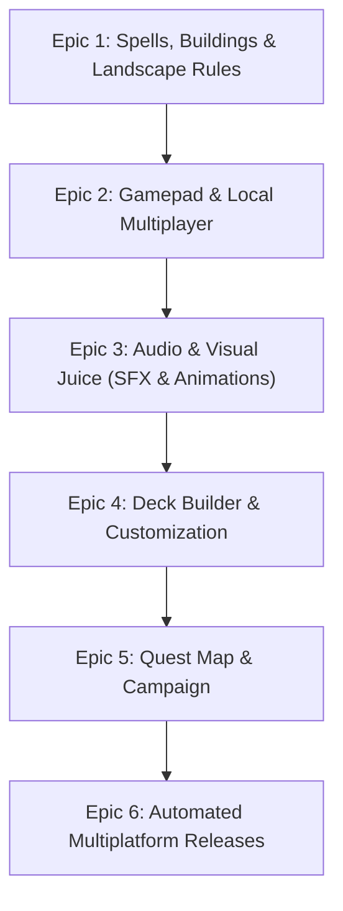

# Card Wars (Godot 4 PC Remake) - Project Backlog

A roadmap and task breakdown for completing the open-source Godot 4 remake of *Adventure Time: Card Wars*, preserving all original game mechanics, blueprint databases, and visual flair while adding modern PC features (Controller Support, Local Multiplayer, and Cross-Platform Standalones).

---

## 📊 Current Implementation Status (Completed)

- [x] **Project Scaffolding**: Godot 4.7+ project configuration, autoloads (`Database.gd`, `GameManager.gd`), and viewport stretch setup.
- [x] **Blueprint & Data Engine**:
  - Dynamically parses and caches **416 original cards** (341 Creatures, 48 Spells, 27 Buildings) from `db_Creatures.json`, `db_Spells.json`, `db_Buildings.json`.
  - Maps and imports **288 authentic card illustrations** (`assets/textures/cardart/`).
  - Parsed **1,127 localized English titles, card descriptions, and ability texts** (`data/strings_en.json`).
- [x] **Core 4-Lane Tactical Combat**:
  - 4 Opponent Lanes vs. 4 Player Lanes with landscape affinities (Corn, Plains, Cotton, Sand, Swamp).
  - Magic Points (MP) progression (starts at 2 MP, increases by 1 each turn up to 10 MP).
  - Card drawing, summoning to empty lanes, and lane clashing (ATK vs. DEF).
  - Direct Hero HP damage when an opposing lane is empty.
  - **Floop Mechanic**: Tapping/flooping creatures, spending floop MP, visual rotation/exhaustion, and core ability scripts (*The Pig*, *Angel Eye*, *Blueberry Djini*, *DamageAll*, etc.).
  - Opponent AI turn execution.
- [x] **Menus & Compendium**:
  - Main Menu with direct battle launch (Finn vs. Jake).
  - Card Compendium modal to browse all original cards and stats.
- [x] **Headless CLI / Runner Tooling**:
  - Headless test verification passing without errors or warnings.
  - Convenience launcher script `scripts/run-godot.sh`.

---

## 🎯 Epics & Task Breakdown

### Epic 1: Full Card System & Advanced Battle Rules

- [ ] **Task 1.1: Spell Cards System**
  - [ ] Implement spell card play directly from hand.
  - [ ] Target selection mode (target creature, target lane, target hero, or board-wide).
  - [ ] Support spell effects: direct damage, stat buffs/debuffs, lane disruption, card drawing, and MP modification.
  - [ ] Implement discard pile resolution for expended spells.
- [ ] **Task 1.2: Building Cards System**
  - [ ] Add dedicated Building Slots behind creatures in each lane slot.
  - [ ] Passive lane modifiers (e.g. `FruitCakeBuilding`: creature in this lane gains DEF; `RedDome`: creature gains ATK).
  - [ ] Building durability / destruction effects (buildings targeted by spells or abilities).
- [ ] **Task 1.3: Landscape Affinity Rules**
  - [ ] Enforce landscape placement restrictions (Corn creatures only on Corn, Plains on Plains, etc.).
  - [ ] Allow Universal cards (`Faction == "Universal"`) on any landscape.
  - [ ] Visual indicator (green border / red border) when dragging or selecting a lane based on affinity.
- [ ] **Task 1.4: Extended Floop Ability Engine**
  - [ ] Implement remaining ability scripts from `db_FloopActions.json` and Unity assemblies:
    - `ReturnDiscardCard` (retrieve card from discard pile to hand).
    - `LowerATKTarget` / `BonusDEFTarget` (targeted stat manipulation).
    - `HealTarget` / `HealAll` (creature and hero recovery).
    - `SacrificeForMP` (destroy friendly creature to gain bonus Magic Points).
    - `MoveBuildingSelf` / `MoveBuildingOpponent` (lane swapping mechanics).
    - `ATKBonusFactionCreatures` (synergy buffs across a faction).
    - `ResetSelf` (unfloop self for multi-use turns).
- [ ] **Task 1.5: Hero Leaders & Active Leader Powers**
  - [ ] Load Leader data (`db_Leaders.json`) for Finn, Jake, Princess Bubblegum, Marceline, BMO, Ice King, Lemongrab, Flame Princess, LSP, etc.
  - [ ] Leader Cooldown Turn Counter (e.g., 3 turns until ready).
  - [ ] Leader Power button on UI with visual charge meter.
  - [ ] Execute leader effects (e.g., Finn: +2 MP; Jake: +3 ATK to all Corn creatures; PB: heal all creatures).
- [ ] **Task 1.6: The Battle Wheel (Roulette Minigame)**
  - [ ] Create the iconic circular spinning battle wheel UI component (`BattleWheel.tscn`).
  - [ ] Read character wheel hit/crit ranges from `db_Leaders.json` (`Ring_P1_HitAreaRange`, `Ring_P1_CritAreaRange`).
  - [ ] Player timing input (Stop button / Spacebar / Controller button):
    - **Critical Hit**: 2x damage multiplier.
    - **Hit**: Standard damage.
    - **Miss / Block**: 0 damage dealt or incoming damage blocked.
  - [ ] Add option in settings to enable/disable or automate the wheel (instant combat toggle).

---

### Epic 2: Controls, Gamepad & Local Multiplayer

- [ ] **Task 2.1: Controller / Gamepad Support**
  - [ ] Implement complete Godot `InputMap` actions for controllers (XInput / Xbox, DualShock/DualSense, Nintendo Switch Pro, Steam Deck).
  - [ ] UI focus navigation (`focus_neighbor_*`) across hand cards, lane slots, Floop buttons, and Attack button.
  - [ ] Controller shortcuts:
    - `D-Pad / Left Stick`: Navigate cards and lanes.
    - `A / Cross`: Select card / summon to lane / confirm.
    - `X / Square`: Floop selected creature.
    - `Y / Triangle`: Inspect card details (zoom view).
    - `R1 / RB`: Trigger Attack / End Turn.
    - `L1 / LB`: Trigger Leader Power.
    - `Start / Menu`: Pause menu.
  - [ ] Dynamic UI prompt icons (switching between Xbox/PlayStation/Keyboard glyphs based on last input device).
- [ ] **Task 2.2: Local Multiplayer (2 Players on Same Machine)**
  - [ ] Add "Local 2-Player Match" to Main Menu.
  - [ ] **Mode A: Dual Controller / Shared Screen**:
    - Player 1 uses Controller 1 (controls bottom lanes).
    - Player 2 uses Controller 2 (controls top lanes).
  - [ ] **Mode B: Pass & Play (Hotseat)**:
    - "Hide Hand" transition screen between turns so players cannot see each other's hidden cards.
  - [ ] Custom deck and landscape selection for both Player 1 and Player 2 before starting.
- [ ] **Task 2.3: Keyboard & Mouse Shortcuts**
  - [ ] Number keys `1`–`8` to quickly select cards in hand.
  - [ ] Number keys `Q`, `W`, `E`, `R` (or `1`-`4`) to target Lanes 1–4.
  - [ ] `Spacebar` / `Enter` for Attack / End Turn.
  - [ ] `Tab` to inspect hovered card in high resolution.
  - [ ] `Esc` for Pause / Options menu.

---

### Epic 3: Audio, Animations & Visual Polish ("Game Juice")

- [ ] **Task 3.1: SFX & Voice Line Integration**
  - [ ] Audio Manager autoload (`AudioManager.gd`) with bus volume controls (Master, Music, SFX, Voice).
  - [ ] Character Voice Lines from `Assets/AudioClip/`:
    - Finn shouts ("Floop the pig!", "Algebraic!").
    - Jake reactions ("Oh man!", "Mathematical!").
    - BMO, Marceline, Princess Bubblegum, Lemongrab voice lines.
  - [ ] Tactical SFX:
    - Card draw whoosh, card placement thump.
    - Floop activation chime / spark sound.
    - Attack strike, critical hit clash, creature destruction explosion.
    - Hero damage grunt and defeat scream.
- [ ] **Task 3.2: Card Battle Animations**
  - [ ] Card draw animation (flying from draw pile into player hand).
  - [ ] Summon animation (card expands and slides into lane slot).
  - [ ] Attack clash animation (creature card jolts forward toward enemy lane).
  - [ ] Floating combat text (`-5 DEF`, `+2 ATK`, `CRIT!`, `BLOCKED!`).
  - [ ] Screen shake on heavy attacks or hero damage.
- [ ] **Task 3.3: Battlefield & UI Visual Upgrades**
  - [ ] Replace dark placeholder panels with authentic 2D Land of Ooo grass/sky environment backgrounds (`AdventureTimeEnvironment*.unity` visual assets).
  - [ ] High-resolution card zoom preview on hover/inspect.
  - [ ] Animated turn transition banners ("PLAYER TURN", "OPPONENT TURN", "BATTLE PHASE").
- [ ] **Task 3.4: Background Music (BGM)**
  - [ ] Main Menu BGM track.
  - [ ] Battle BGM tracks (standard battle, intense battle when Hero HP < 10).
  - [ ] Victory fanfare ("Cool Guy Cup") and Defeat music ("Dweeb Cup").

---

### Epic 4: Deck Builder & Customization

- [ ] **Task 4.1: Deck Builder Interface (`DeckBuilder.tscn`)**
  - [ ] Filter cards by Faction (Plains, Corn, Cotton, Sand, Swamp, Universal).
  - [ ] Filter cards by Type (Creature, Spell, Building) and Cost (1 to 5+ MP).
  - [ ] Card search bar by name.
  - [ ] Deck legal validation (minimum 10 cards, maximum 25 cards, duplicate limits).
- [ ] **Task 4.2: Landscape Customizer**
  - [ ] Allow choosing 4 landscape tiles for your deck (e.g. 2 Corn, 2 Plains, or 4 Cotton).
- [ ] **Task 4.3: Leader Selection Screen**
  - [ ] Choose active Hero Leader portrait and power for the deck.
- [ ] **Task 4.4: Save & Load System**
  - [ ] Save custom decks as JSON files in `user://decks/`.
  - [ ] Support multiple named deck slots (e.g. "Finn's Rush", "Jake's Corn Army", "Marceline Vamp").

---

### Epic 5: Campaign & Progression

- [ ] **Task 5.1: Quest Map System (`QuestMap.tscn`)**
  - [ ] World map nodes connecting through the Land of Ooo based on `db_Quest.json` (Quests 1 to 120+).
  - [ ] Visual road unlocking upon victory.
  - [ ] Dialogue cutscenes before matches using character portraits.
- [ ] **Task 5.2: Star Objectives & Quest Conditions**
  - [ ] Parse `db_QuestConditions.json`:
    - Win with > 15 Hero HP.
    - Win without flooping any creatures.
    - Win in under 5 turns.
  - [ ] 3-star rating system per quest node.
- [ ] **Task 5.3: Card Chest / Gacha Rewards**
  - [ ] In-game Coin and Gem currency rewards from battles (no real money / microtransactions).
  - [ ] Chest opening screen (`db_GachaWeights.json`):
    - Regular Chest (Coins) & Algebraic Chest (Gems).
    - Card reveal animation with rarity glows (Common, Rare, Very Rare, Algebraic).
- [ ] **Task 5.4: Card Fusion & Crafting**
  - [ ] Card fusion screen based on `db_Fusion.json`:
    - Combine duplicate cards and recipe items to upgrade creature stats (Standard -> Gold -> Obsidian).

---

### Epic 6: Multiplatform Packaging & CI/CD

- [ ] **Task 6.1: Godot 4 Linux Standalone & AppImage**
  - [ ] Automated headless export preset in Godot for Linux x86_64 (`CardWars.x86_64`).
  - [ ] Package into single-file portable `CardWars-x86_64.AppImage` using `appimagetool`.
- [ ] **Task 6.2: Godot 4 Windows Standalone**
  - [ ] Automated headless export preset for Windows 64-bit (`CardWars.exe`).
  - [ ] Zipped release package (`CardWars-Windows.zip`).
- [ ] **Task 6.3: Godot 4 macOS Standalone**
  - [ ] Automated export for macOS (`CardWars.app`).
  - [ ] Zipped release package (`CardWars-macOS.zip`).
- [ ] **Task 6.4: Steam Deck & Linux Desktop Integration**
  - [ ] `.desktop` application entry and icon installation script.
  - [ ] Steam Deck controller preset and 1280x800 resolution support.
- [ ] **Task 6.5: Zero-License GitHub Actions Workflow**
  - [ ] Set up GitHub Actions using official Godot 4 export action (requires **zero licenses, zero serial numbers, and zero third-party accounts**).
  - [ ] Automatic release generation on tag push (`v*`).

---

## 🛠 Suggested Development Order

