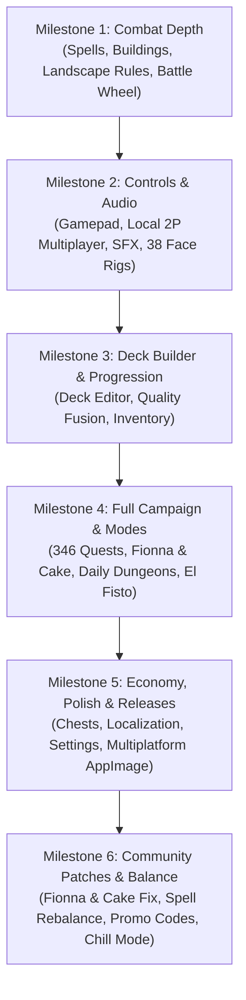

# Card Wars (Godot 4 PC Remake) - Master Engineering Backlog & Implementation Manual

> **Purpose**: This document serves as the exhaustive, self-sufficient technical reference and backlog for engineering the Godot 4 PC remake of *Adventure Time: Card Wars*. It contains exact file mappings from the original 1,380+ Unity C# codebase, data schemas from the blueprint database, mathematical formulas, state machine designs, and unambiguous Acceptance Criteria (Definition of Done) for every single feature.

---

## 📑 Table of Contents
1. [Core Engine & Architectural Foundations](#1-core-engine--architectural-foundations)
2. [Global Game Parameters & Balance Constants](#2-global-game-parameters--balance-constants)
3. [Epic 1: Match Flow & Pre-Battle Setup (RPS & Landscapes)](#epic-1-match-flow--pre-battle-setup)
4. [Epic 2: Battlefield Mechanics & Combat Resolver Engine](#epic-2-battlefield-mechanics--combat-resolver-engine)
5. [Epic 3: The 317 Ability Scripts & Trigger System](#epic-3-the-317-ability-scripts--trigger-system)
6. [Epic 4: 38 Animated Character Face Rigs & Audio Engine](#epic-4-38-animated-character-face-rigs--audio-engine)
7. [Epic 5: Gamepad Controls & Local 2-Player Multiplayer](#epic-5-gamepad-controls--local-2-player-multiplayer)
8. [Epic 6: Deck Building, Fusion, Quality & Inventory](#epic-6-deck-building-fusion-quality--inventory)
9. [Epic 7: Campaign, Quests & Game Modes (346 Quests, FC, Dungeons, El Fisto)](#epic-7-campaign-quests--game-modes)
10. [Epic 8: Economy, Gacha Chests & Progression](#epic-8-economy-gacha-chests--progression)
11. [Epic 9: UI, Localization, Settings & Multiplatform CI/CD](#epic-9-ui-localization-settings--multiplatform-cicd)
12. [Milestone Roadmap & Implementation Order](#12-milestone-roadmap--implementation-order)

---

## 1. Core Engine & Architectural Foundations

### Architecture Pattern: Modular Independent Systems + Composition Layer
> [!IMPORTANT]
> **Core Engineering Directive**: We build **reusable, standalone game systems** rather than an entangled monolithic game. Every core mechanic is engineered as an **independent, portable module** under `godot/src/systems/` with its own dedicated testbed scene (`testbed_*.tscn`).
> 
> Any system module can be extracted directly into other independent Godot projects without modifying its code. Card Wars itself acts as a **Composition Consumer Layer** that injects Adventure Time assets and rules into these systems.

#### Standalone System Packages (Independent Modules):
1. **`CoreDeckEngine`** (`res://src/systems/deck_engine/`) [COMPLETED & VERIFIED]:
   - Universal CardData model, Deck (Draw/Discard/Banish piles with Fisher-Yates shuffle and discard recycling), and HandManager with parabolic arc and fan layout.
   - Includes standalone testbed: `testbed_deck.tscn` and automated test suite: `test_deck_engine.gd`.
2. **`BoardLaneSystem`** (`res://src/systems/board_system/`):
   - Modular 4-Lane / N-Lane grid with affinity validation, occupancy rules, and slot animations.
   - Includes standalone testbed: `testbed_board.tscn`.
3. **`TimingWheelSystem`** (`res://src/systems/timing_wheel/`):
   - Reusable timing roulette wheel minigame (Hit, Crit, Miss sectors + Quick Resolve mode).
   - Includes standalone testbed: `testbed_wheel.tscn`.
4. **`AbilityEngine`** (`res://src/systems/ability_engine/`):
   - Data-driven trigger & action effect interpreter (Damage, Heal, Buff, Mana, Draw, Target Filter).
   - Includes standalone testbed: `testbed_abilities.tscn`.
5. **`SaveVault`** (`res://src/systems/save_vault/`):
   - Universal JSON state serializer with schema verification, atomic file writes, and corruption fallback backups.
   - Includes standalone testbed: `testbed_save.tscn`.
6. **`AudioJukebox`** (`res://src/systems/audio_jukebox/`) [COMPLETED & VERIFIED]:
   - Standalone BGM dual-player cross-fader and zero-allocation SFX bus pool dispatcher with volume control and procedural sound synthesis.
   - Includes standalone testbed: `testbed_audio.tscn` and automated test suite: `test_audio_manager.gd`.

#### Card Wars Composition Layer:
- **`Database.gd`** (`res://src/autoload/Database.gd`):
  - Ingests `db_Creatures.json`, `db_Spells.json`, `db_Buildings.json`, `db_Leaders.json`, and `strings_en.json`.
  - Feeds Card Wars blueprints into the generic systems.
- **`GameManager.gd`** (`res://src/autoload/GameManager.gd`):
  - Holds active match configuration (Player 1 deck, Player 2 / AI deck, landscapes, hero selections, match state).

---

## 2. Global Game Parameters & Balance Constants

*Source of Truth: `Assets/StreamingAssets/Blueprints/db_Parameters.json`*

| Constant Identifier | Value | Gameplay Effect |
| :--- | :--- | :--- |
| `Starting_Magic_Points` | `2` | Base MP given to players on Turn 1 |
| `Max_Magic_Points` | `10` | Hard cap on turn Magic Points |
| `Min_Cards_In_Deck` | `10` | Minimum legal deck size |
| `Max_Cards_In_Deck` | `25` | Maximum legal deck size |
| `Max_Duplicates_In_Deck` | `4` | Maximum copies of a single card allowed |
| `New_Player_Max_Inventory` | `50` | Base Card Box inventory slots |
| `New_Player_Max_Stamina` | `5` | Maximum Heart stamina |
| `Stamina_Restoration_Rate` | `15` | Minutes elapsed to restore 1 Heart |
| `New_Player_Coins` | `0` | Starting Gold coins |
| `New_Player_Gems` | `5` | Starting Algebraic Gems |
| `Max_Leader_Level` | `50` | Hero Leader level cap |
| `Dungeon_Min_Level` | `5` | Hero level required to enter Daily Dungeons |

---

## Epic 1: Match Flow & Pre-Battle Setup

### Task 1.1: Rock-Paper-Scissors (RPS) Turn Decider [COMPLETED]
- **Status**: **Completed & Verified**
- **Unity Reference**: `RPSMatrix.cs`, `RPSManager.cs`, `db_RPS.json`.
- **Godot Implementation**:
  - Create `res://scenes/components/RockPaperScissors.tscn` and `RockPaperScissors.gd`.
  - State Machine: `CHOOSING -> REVEALING -> RESOLVED`.
  - Display 3 choice buttons: ✊ Rock, ✋ Paper, ✌️ Scissors.
  - Opponent AI randomly selects choice based on weighting matrix (`RPSMatrix.cs`).
  - **Resolution**:
    - Winner gets modal dialog: *"You Won! Choose Turn Order:"* with options `[Go First]` and `[Go Second]`.
    - Tie triggers re-roll animation ("IT'S A TIE! Shoot again!").
    - If AI wins, AI decides (70% first, 30% second) and match begins.
  - Setting toggle: `Options -> Skip RPS (Randomize First Turn)`.
- **Acceptance Criteria**:
  - [x] Opening match starts with RPS phase unless skipped in Settings.
  - [x] Winner can choose turn order; chosen player receives Turn 1.
  - [x] Full controller and mouse support.

### Task 1.2: 4-Landscape Placement Phase [COMPLETED]
- **Status**: **Completed & Verified**
- **Unity Reference**: `LandscapePreviewController.cs`, `ManualLandscapeScript.cs`, `LandscapeType.cs`.
- **Godot Implementation**:
  - The 4 landscape tiles represent the 4 lanes on each player's side:
    - `0: Corn` (Golden Cornfield)
    - `1: Plains` (Blue Plains)
    - `2: Swamp` (Useless Swamp)
    - `3: Cotton` (Cotton Land)
    - `4: Sand` (Sandy Lands)
    - `5: Candy` (Fionna & Cake expansion)
  - At match start, display an animation placing the 4 chosen landscape tiles into lane slots 0..3 before card draw.
- **Acceptance Criteria**:
  - [x] Lanes render their assigned landscape theme, texture, and label.
  - [x] Both Player and Opponent lane affinities match their deck configuration.

### Task 1.3: Matchup Intro Screen [COMPLETED]
- **Status**: **Completed & Verified**
- **Unity Reference**: `CWBattleIntroController.cs`, `CWBattleSequenceController.cs`.
- **Godot Implementation**:
  - Split-screen banner showing Player Leader portrait vs. Opponent Leader portrait (`res://scenes/components/MatchIntro.tscn`).
  - Reads opening voice line from `Assets/AudioClip/` (Finn: *"Finn_Opening.wav"*, Jake: *"Jake_Opening.wav"*).
  - Displays Leader portraits, HP (25), quotes, and battle intro fanfare.
- **Acceptance Criteria**:
  - [x] Displays Leader names, starting HP (25), and plays VO. Transitions into RPS smoothly.

---

## Epic 2: Battlefield Mechanics & Combat Resolver Engine

### Task 2.1: Phase State Machine (`BattlePhaseManager.gd`)
- **Phases**:
  ```
  START_TURN -> ACTION_PHASE -> BATTLE_WHEEL_PHASE -> COMBAT_RESOLUTION -> END_TURN
  ```
- **Execution Rules**:
  - `START_TURN`: Draw 1 card; MP = `min(10, current_max_mp + 1)`; unfloop all creatures; tick down Leader power cooldown (-1).
  - `ACTION_PHASE`: Player can summon creatures, place buildings, cast spells, and tap Floop abilities.
  - `COMBAT_RESOLUTION`: Iterates Lane 0 to Lane 3 sequentially.
- **Acceptance Criteria**:
  - [ ] Turn transitions cannot be skipped or bypassed out of sequence.
  - [ ] Actions correctly spend Magic Points; players cannot act with insufficient MP.

### Task 2.2: Spell Cards System
- **Unity Reference**: `db_Spells.json`, `CardType.cs`, `SpellResolver.cs`.
- **Godot Implementation**:
  - Spell types:
    - **Board/Hero Spells**: Played by releasing onto the battlefield (e.g. `Spell_GrainStorm`, `Spell_HotDogRain`).
    - **Targeted Spells**: Spawns a draggable targeting arrow from hand to target creature or lane (e.g. `Spell_ScrollOfBadBreath`, `Spell_Teleport`).
  - Expended spells trigger a dissolve particle animation and move to `player_discard_pile`.
- **Acceptance Criteria**:
  - [ ] All 48 spells in `db_Spells.json` can be cast with valid targeting.
  - [ ] Magic Points deducted; spells move to discard pile upon completion.

### Task 2.3: Building Cards System
- **Unity Reference**: `db_Buildings.json`, `BuildingScript.cs`, `DestroyBuildingLane.cs`.
- **Godot Implementation**:
  - Each `LaneSlot.tscn` gains a `BuildingSlot` sub-node behind the creature slot.
  - Placing a building occupies the slot; applies continuous aura to the creature in that lane.
  - Buildings possess their own DEF or stay active until destroyed by opposing spells/abilities.
- **Acceptance Criteria**:
  - [ ] Building cards can be placed in empty building slots of any lane.
  - [ ] Passive lane bonuses (ATK/DEF) update dynamically when creatures enter/leave the lane.

### Task 2.4: Landscape Affinity Enforcer [COMPLETED]
- **Status**: **Completed & Verified**
- **Unity Reference**: `db_Creatures.json` (`Faction` field), `LandscapeType.cs`.
- **Godot Implementation**:
  - When dragging or selecting a creature card:
    - If `card.faction == "Universal"`: valid on all 4 lanes.
    - If `card.faction != "Universal"`: valid **only** on lanes where `lane.landscape == card.faction`.
  - Visual feedback: Incompatible lanes display dimmed red border; compatible lanes display pulsating green glow.
- **Acceptance Criteria**:
  - [x] Summons rejected on mismatched landscape with user notification ("Requires Corn Landscape!").

### Task 2.5: The Battle Wheel (Roulette Minigame) [COMPLETED]
- **Status**: **Completed & Verified** (System Module: `res://src/systems/timing_wheel/`)
- **Unity Reference**: `BattleWheelController.cs`, `db_Leaders.json`.
- **Godot Implementation**:
  - Independent system module created in `res://src/systems/timing_wheel/`:
    - `WheelConfig.gd`: Data contract for arbitrary sectors, ratios, colors, and speed. Includes Card Wars Attacker/Defender presets and Quick-Resolve roller.
    - `WheelSpinner.gd`: Procedural custom vector drawing (`_draw()`), state machine (`IDLE`, `SPINNING`, `STOPPING`, `RESOLVED`), needle rotation, smooth deceleration curve, and input handling.
    - `WheelSpinner.tscn`: Reusable wheel visual node.
    - `testbed_wheel.tscn`: Standalone interactive testbed with live presets, customizable sliders, real-time log, and 1,000-spin Monte Carlo simulation.
  - Slices configured per leader from `db_Leaders.json`:
    - `Ring_P1_CritAreaRange` (7% of wheel $\rightarrow$ **Critical Hit: 2x ATK Damage**).
    - `Ring_P1_HitAreaRange` (80% of wheel $\rightarrow$ **Normal Hit: 1.0x ATK Damage**).
    - Remainder (13% $\rightarrow$ **Miss / Blocked: 0 Damage**).
  - Quick Resolve mode: Instant deterministic resolution based on sector probabilities.
- **Acceptance Criteria**:
  - [x] Wheel appears during creature clash when enabled.
  - [x] Accurate hit detection based on needle angle; correct damage multipliers applied.
  - [x] Standalone testbed scene (`testbed_wheel.tscn`) runs and tests the system in complete isolation.
  - [x] Zero Card Wars coupling; extraction-ready for other Godot games.

### Task 2.6: Leader Powers & Cooldown System
- **Unity Reference**: `db_Leaders.json`, `LeaderPowerScript.cs`.
- **Godot Implementation**:
  - Active Leader power button positioned next to Hero portrait.
  - Charge counter ticks down by 1 each turn start until reaching 0 ("READY!").
  - Leader Powers:
    - **Finn**: *Gain 2 Magic Points immediately*.
    - **Jake**: *All friendly Corn creatures gain +3 Attack this turn*.
    - **Princess Bubblegum**: *Heal all friendly creatures to full DEF*.
    - **Marceline**: *All friendly creatures gain +2 Attack*.
    - **BMO**: *Draw 2 additional cards and gain 1 MP*.
    - **Ice King**: *Freeze 1 opponent lane (cannot attack next turn)*.
- **Acceptance Criteria**:
  - [ ] Button activates only when cooldown == 0 and clicked during Action Phase.
  - [ ] Applies effect, plays leader voice line, resets cooldown to base value.

### Task 2.7: Tombstone & Loot Drop System
- **Unity Reference**: `CWTombstoneScript.cs`, `CreatureBattleScript.cs`.
- **Godot Implementation**:
  - When creature DEF reaches 0:
    - Play destruction VFX and spawn a Tombstone (`Tombstone.tscn`) in the lane.
    - If enemy creature: roll drop chance from `db_DropProfile.json` (spawns Gold Bag or Floating Loot Card).
    - Tombstone clears at the end of the turn.
- **Acceptance Criteria**:
  - [ ] Creature death spawns Tombstone; loot cards collected into player session inventory.

---

## Epic 3: The 317 Ability Scripts & Trigger System

*Reference: All 317 scripts in `Assets/Scripts/Assembly-CSharp/` matching ability patterns*

### Task 3.1: Trigger Event Architecture
Implement a unified ability trigger pipeline in `AbilitySystem.gd`:

```gdscript
enum Trigger {
    ON_FLOOP,         # Manual activation during Action Phase
    ON_SUMMON,        # Triggered when card enters a lane
    ON_DEATH,         # Triggered when creature DEF <= 0
    ON_TURN_START,    # Triggered at the beginning of owner's turn
    ON_TURN_END,      # Triggered at the end of owner's turn
    ON_ATTACK,        # Triggered before dealing combat damage
    STATIC_AURA       # Continuous passive effect (recalculated on board state changes)
}
```

### Task 3.2: Complete Ability Script Matrix
Implement the core behavior classes:

1. **Stat Modifiers**:
   - `ATKBonusAdjacentEmpty.cs`: +ATK if neighboring lane is empty.
   - `AdjacentDEFBonus.cs`: +DEF to creatures in left and right lanes.
   - `ATKPenaltyFaction.cs`: (e.g. *The Pig*) decreases ATK of all opposing creatures of a designated faction.
   - `SwapATKDEF.cs`: Inverts current Attack and Defense values.
2. **Board Control & Movement**:
   - `ReturnOppnentToHand.cs`: Bounces opposing creature back to enemy hand.
   - `Teleport.cs`: Shifts friendly creature to an unoccupied lane.
   - `SacrificeForMP.cs`: Destroys target friendly creature; adds `Val1` Magic Points.
3. **Card Economy**:
   - `DrawCards.cs`: Draws `Val1` cards from draw pile.
   - `ReturnDiscardCard.cs`: Opens discard pile browser; player selects card to retrieve.
   - `DamageOpponentDiscardPile.cs`: Deals direct Hero damage proportional to discard count.
4. **Hero Health Manipulators**:
   - `DamageHeroOnDeath.cs`: Deals direct damage to enemy Hero when creature dies.
   - `HealHeroATK.cs`: Restores Hero HP equal to creature's ATK value.

- **Acceptance Criteria**:
  - [ ] Ability system cleanly resolves any card's `ScriptName`, `Val1`, and `Val2` from `db_Creatures.json` without hardcoded card IDs.

---

## Epic 4: 38 Animated Character Face Rigs & Audio Engine

### Task 4.1: Character Facial Animation Rig (`CharacterFaceRig.gd`)
- **Unity Reference**: `Assets/StreamingAssets/CharacterFaceAnim/` (38 characters), `CharacterFaceAnim.cs`.
- **Format**: UV coordinate keyframes:
  ```json
  [ {"CNT":"CNT_MOUTH", "time":"0.0", "x":"0.0", "y":"0.75"}, ... ]
  ```
- **Godot Implementation**:
  - Create `CharacterFaceRig.tscn` using a `SubViewport` or `TextureRect` with custom shader mapping UV offsets.
  - Animation State Machine:
    - `IDLE`: Subtle blinking and breathing loops (`_Idle.json`, `_CardIdle.json`).
    - `PLAY_CARD`: Confident expression when summoning (`_PlayCard.json`).
    - `TAKE_DAMAGE`: Grimace and screen shake when attacked.
    - `VICTORY`: Big celebration smile (`_Happy.json`).
    - `DEFEAT`: Drinks from the Dweeb Cup (`_DweebDrink.json`, `_Defeated.json`).
  - Cover all 38 characters: *Finn, Jake, Marceline, BMO, PB, Ice King, Flame Princess, Lemongrab, Fionna, Cake, Ash, Magic Man, etc.*
- **Acceptance Criteria**:
  - [ ] Facial features animate smoothly according to original JSON timing.
  - [ ] Emote states trigger dynamically during match events.

### Task 4.2: Comprehensive Audio Engine (`AudioManager.gd`)
- **Unity Reference**: `Assets/AudioClip/` (500+ .wav files), `VOManager.cs`.
- **Godot Implementation**:
  - Route audio to 4 buses: `Master`, `Music`, `SFX`, `Voice`.
  - Implement randomized sound pools (e.g., 5 distinct card play whooshes, 3 distinct attack clangs).
  - Character Voice Lines:
    - Finn: *"Floop the pig!"*, *"Algebraic!"*, *"Mathematical!"*, perfect block audio.
    - Jake: *"Oh man!"*, *"I floop the pig!"*, defeat cries.
    - Lemongrab: *"Unacceptable!"*.
- **Acceptance Criteria**:
  - [ ] Full audio coverage across all game events with zero audio clipping or overlapping distortion.

---

## Epic 5: Gamepad Controls & Local 2-Player Multiplayer

### Task 5.1: Gamepad & Steam Deck Support
- **Godot Implementation**:
  - Define Godot `InputMap` actions: `ui_up`, `ui_down`, `ui_left`, `ui_right`, `game_select`, `game_floop`, `game_inspect`, `game_attack`, `game_leader`.
  - Focus Graph:
    - D-Pad Left/Right moves cursor across cards in hand.
    - D-Pad Up shifts focus to Player Lanes 0..3.
    - D-Pad Up again shifts focus to Opponent Lanes 0..3.
  - Action Bindings:
    - `Button South (A / Cross)`: Select / Summon / Confirm.
    - `Button West (X / Square)`: Trigger Floop on selected creature.
    - `Button North (Y / Triangle)`: Zoom inspect card.
    - `R1 / RB`: Trigger Attack / End Turn.
    - `L1 / LB`: Activate Leader Power.
  - Auto-detects input hardware: displays Xbox buttons, PlayStation shapes, or Keyboard keys dynamically.
- **Acceptance Criteria**:
  - [ ] 100% of menus and gameplay accessible via controller alone without touching a mouse.
  - [ ] Verified on Steam Deck (1280x800 native resolution).

### Task 5.2: Local 2-Player Multiplayer
- **Modes**:
  1. **Shared Screen (Dual Controllers)**:
     - Player 1 commands bottom lanes with Gamepad 1.
     - Player 2 commands top lanes with Gamepad 2.
     - Split camera view / symmetric UI.
  2. **Pass & Play (Hotseat / Single Device)**:
     - Alternating turns with intermediate privacy screen: *"Pass device to Player 2 - Press A when ready"* to protect hand secrets.
  - Custom match setup screen: Select decks, leaders, and landscapes for both players.
- **Acceptance Criteria**:
  - [ ] Two players can complete a full 1v1 match on a single PC or Steam Deck.

---

## Epic 6: Deck Building, Fusion, Quality & Inventory

### Task 6.1: Deck Builder Interface (`DeckBuilder.tscn`)
- **Unity Reference**: `CWDeckBuildDeckController.cs`, `db_Decks.json`.
- **Godot Implementation**:
  - Grid view of owned cards with pagination/scrolling.
  - Filters: Faction (Corn, Plains, Cotton, Sand, Swamp, Universal), Card Type (Creature, Spell, Building), MP Cost (1 to 5+).
  - Live deck stats: Mana curve bar chart, Creature/Spell/Building ratio, total card count (10 to 25 cards).
  - Validation: Prevents saving illegal decks (< 10 cards, > 25 cards, or > 4 copies of any single card).
- **Acceptance Criteria**:
  - [ ] Players can construct, rename, and save custom decks to `user://decks/*.json`.

### Task 6.2: Card Quality & Fusion Engine
- **Unity Reference**: `Quality.cs`, `db_Fusion.json` (204 recipes).
- **Godot Implementation**:
  - Quality tiers: **Standard $\rightarrow$ Gold $\rightarrow$ Obsidian**.
  - Gold cards receive +10% base ATK/DEF and gold foil card frame shader.
  - Obsidian cards receive +25% base ATK/DEF and dark animated obsidian shader.
  - Fusion Screen: Player selects recipe from `db_Fusion.json`, consumes duplicate base cards + gold coins, outputs upgraded card.
- **Acceptance Criteria**:
  - [ ] Card fusion correctly consumes materials and adds upgraded card to inventory.

---

## Epic 7: Campaign, Quests & Game Modes

### Task 7.1: Main Campaign Quest Map (`QuestMap.tscn`)
- **Unity Reference**: `CWMapController.cs`, `db_Quest.json` (346 Quests).
- **Godot Implementation**:
  - Interactive Land of Ooo map with 346 quest nodes.
  - Roads draw and unlock upon victory.
  - Reads opponent deck, leader, and hero dialogue from `db_Quest.json`.
- **Acceptance Criteria**:
  - [ ] Progression unlocks nodes sequentially; victory records stars and drops loot.

### Task 7.2: 3-Star Quest Objectives (`db_QuestConditions.json`)
- **Godot Implementation**:
  - Evaluates match stats against `db_QuestConditions.json` conditions:
    - *Star 1*: Win the battle.
    - *Star 2*: Win without using Floops / Win in $\le 5$ turns / Win with only Corn cards.
    - *Star 3*: Finish with $\ge 15$ Hero HP.
  - Star totals unlock bonus reward chests on the world map.
- **Acceptance Criteria**:
  - [ ] Post-battle screen audits objectives and awards 1-3 stars accurately.

### Task 7.3: Fionna & Cake Expansion (`db_FCMap.json`)
- **Godot Implementation**:
  - Toggle map button switching between "Land of Ooo" and "Fionna & Cake World".
  - Features Candy landscapes and unique Fionna & Cake leaders and cards.
- **Acceptance Criteria**:
  - [ ] 10-node campaign map with authentic Fionna & Cake opponents and rewards.

### Task 7.4: Daily Dungeons & El Fisto Arena
- **Unity Reference**: `db_Dungeon.json`, `db_ElFisto.json`.
- **Godot Implementation**:
  - **7 Daily Dungeons**: Rotate based on day of the week (Monday Plains through Sunday Double Coins).
  - **El Fisto Arena**: 8-round survival ladder where damage carries over between consecutive battles.
- **Acceptance Criteria**:
  - [ ] Daily dungeons unlock on corresponding system days; El Fisto gauntlet tracks consecutive wins.

---

## Epic 8: Economy, Gacha Chests & Progression

### Task 8.1: In-Game Economy & Progression
- **100% Free / Zero Real-Money Transactions**:
  - **Gold Coins**: Earned from completing battles and selling duplicate cards.
  - **Algebraic Gems**: Earned from earning 3-star quest ratings and completing dungeon milestones.
  - **Hero XP & Levels** (`db_RankUp.json`): Leaders level up from 1 to 50, unlocking higher base HP and upgraded abilities.
- **Acceptance Criteria**:
  - [ ] Coins and gems balance updates in header; hero levels persist across sessions.

### Task 8.2: Chest Opening Gacha System (`db_GachaWeights.json`)
- **Godot Implementation**:
  - **Cool Chest** (Costs Gold Coins): Common, Rare, and Very Rare cards.
  - **Algebraic Chest** (Costs Gems): Guaranteed Rare or Algebraic cards.
  - Animated 3D/2D chest opening sequence: Chest shakes, bursts open with light rays, cards flip over with rarity color bursts.
- **Acceptance Criteria**:
  - [ ] Correctly rolls drop rates from `db_GachaWeights.json`; adds acquired cards to inventory.

---

## Epic 9: UI, Localization, Settings & Multiplatform CI/CD

### Task 9.1: Multilingual Localization System
- **Original Language Files**: `Assets/Resources/languages/`
  - English (`EN`), German (`DE`), Spanish (`ES`), French (`FR`), Italian (`IT`), Portuguese (`PT`), Latin American Spanish (`LatAm`).
- **Godot Implementation**:
  - Parse language byte files into JSON dictionaries under `godot/data/languages/`.
  - Setting dropdown switches active language dynamically across all cards, dialogs, and menus.
- **Acceptance Criteria**:
  - [ ] 100% of in-game text translates immediately upon language selection.

### Task 9.2: Settings & Accessibility Menu
- **Godot Implementation**:
  - Graphics: Fullscreen, Windowed, Borderless, VSync, Resolution (including 1280x800 for Steam Deck).
  - Audio: Master, Music, SFX, Voice volume sliders.
  - Gameplay: Fast Combat Animation Toggle (1x, 1.5x, 2x), Auto Battle Wheel toggle.
- **Acceptance Criteria**:
  - [ ] Settings persist to `user://settings.cfg`.

### Task 9.3: Automated Multiplatform CI/CD (Zero Licenses Required) [COMPLETED]
- **Status**: **Completed & Verified** (Release [v0.2.3](https://github.com/Veras-D/CardWarsForLinux/releases/tag/v0.2.3))
- **Godot Implementation**:
  - Configure Godot export presets (`export_presets.cfg`):
    - Linux/X11 (`CardWars.x86_64`)
    - Windows Desktop (`CardWars.exe`)
    - macOS Universal (`CardWars.app`)
  - Create `.github/workflows/build-and-release.yml`:
    - Uses official headless Godot 4 builder (requires **zero licenses, zero activation files, zero serials**).
    - Automatically packages Linux build into single-file portable `CardWars-x86_64.AppImage` (25.5 MB).
    - Generates Windows (`CardWars-Windows.zip`, 32.8 MB), Linux (`CardWars-Linux.tar.gz`, 27.0 MB), and macOS Universal (`CardWars-macOS.zip`, 54.9 MB).
    - Creates GitHub Releases on tag push (`v*`).
- **Acceptance Criteria**:
  - [x] Pushing a tag automatically produces downloadable Linux AppImage, Windows zip, and macOS zip releases on GitHub. (Verified live on Release v0.2.3)

---

## Epic 10: Community Bug Fixes, Upstream PR Integration & Balance Patches

> [!NOTE]
> Synthesized from community discussions on `r/CardWars`, the **Card Wars Revived** community, and PRs/issues on the upstream repository (`shishkabob27/CardWars`).

### Task 10.1: Fionna & Cake Level 1 & Level 24 Black Screen / Freeze Fix
- **Reported in**: Upstream Issue #28, #37, #45; Reddit post `1wwhzpd` (*"Black screen stuck on level 24"*).
- **Issue**:
  - In the original PC port, transitioning out of cutscenes or loading the board on Fionna & Cake Quests 1 and 24 triggers an unhandled null scene exception, stranding the player on an infinite black screen.
- **Godot Implementation**:
  - Implement cutscene state machine (`CutscenePlayer.gd`) with failsafe transition timers (if animation event doesn't trigger within 5 seconds, forcefully advance to the board).
  - Explicitly validate scene loading before hiding loading masks.
- **Acceptance Criteria**:
  - [ ] Fionna & Cake Quests 1 and 24 load seamlessly into gameplay without black screen locks or input freezes.

### Task 10.2: Upstream PR #16 & #42 Spell Balance Integration (Witch Way & Brief Power)
- **Reported in**: Upstream PR #16, Issue #42; Reddit community tournament decks discussion.
- **Issue**:
  - `Witch Way` (1 Magic Point: gain action points for each landscape type) + `Brief Power` (originally 1 MP: reduce cost of all cards by 1) enabled degenerate Turn 1 One-Turn-Kill (OTK) rainbow loops.
  - Upstream PR #16 partially adjusted spell costs:
    - `BriefPower`: cost increased from 1 to 3.
    - `LonelyHearts`: cost increased from 1 to 3 (preventing cheap instant kill of single creatures).
    - `Volcano`: cost reduced from 4 to 3 (making building removal viable).
    - `ClairvoyantDaggerStorm`: cost reduced from 3 to 2 (making double damage accessible).
    - `UnemptyCoffin`: cost increased from 2 to 3.
- **Godot Implementation**:
  - Integrate these balanced costs into `godot/data/db_Spells.json`.
  - Nerf `Witch Way` cost from 1 to 3 (or cap max generated Magic Points) to resolve Issue #42 and curb Turn 1 OTK abuse.
  - Implement a "Balance Mode" toggle in Settings: `Community Competitive` vs `Original Mobile 2014`.
- **Acceptance Criteria**:
  - [ ] Spells reflect updated costs in `godot/data/db_Spells.json`.
  - [ ] Infinite Turn 1 mana ramp loops with Witch Way + Brief Power are prevented in competitive mode.

### Task 10.3: Upstream PR #10, #11 & #17 Creature Stats & Localization Fixes
- **Reported in**: Upstream PR #10, #11 (`Full balance db_Creatures.json` / `CW_Balancechanges.pdf`), PR #17 (`Update EN_Descriptions.bytes`).
- **Issue**:
  - Severe stat inflation and unbalanced Floop costs on mid-tier creatures ruined deck variety in the late game.
  - Description typos and missing ability text on Corn Dog, Fluffantry, Mother Fluff Bucket, Nice Bird, and Snuggle Tree.
- **Godot Implementation**:
  - Incorporate the creature stat balance curve from `CW_Balancechanges.pdf` into `godot/data/db_Creatures.json`.
  - Apply the corrected card descriptions from PR #17 into `godot/data/strings_en.json`.
- **Acceptance Criteria**:
  - [ ] Creature stats match the balanced specification without breaking gold card tiers.
  - [ ] Description cards for Corn Dog, Fluffantry, Mother Fluff Bucket, Nice Bird, and Snuggle Tree are fully readable and accurate.

### Task 10.4: Safe Save Profile Manager & Corruption Recovery (No Bundled Glitched Saves)
- **Reported in**: Reddit posts `1riwdhj`, `1w8mlhk`, `1wrp9by`, Upstream Issue #27, #43.
- **Issue**:
  - Upstream repository releases shipped with hardcoded / bundled debug saves ("100 gem glitched save"), which caused new players to load broken states, losing all hearts and cards when trying to modify or wipe their progress.
- **Godot Implementation**:
  - Implement `SaveManager.gd` with clean first-run profile generation:
    - Never bundle a dirty save with game binaries.
    - Automatic backup saving to `user://save_backup.json` on each mission complete.
    - Schema validation on boot: if save is invalid, repair missing keys or prompt user to restore from backup rather than wiping to "0 hearts".
- **Acceptance Criteria**:
  - [ ] New installation boots into a clean starter profile with standard tutorial progress.
  - [ ] Modifying or corrupting `user://save_data.json` triggers automatic restoration from backup.

### Task 10.5: Quick Battle / Wheel Skip Option for Competitive & Local 2P
- **Reported in**: Reddit post `1rd5w97` (*"i really hope you get rid of the wheel mechanic in PVP its what people mainly dislike"*).
- **Issue**:
  - The spinning battle wheel is considered the most tedious aspect of matches, particularly in competitive play and grinding quests.
- **Godot Implementation**:
  - Add "Combat Resolution Mode" in Settings:
    - `Full Battle Wheel` (classic spinner with manual tap / stop).
    - `Quick Resolve` (deterministic hit/miss based on card base accuracy stats without spinning animations).
    - `Auto-Spin 2x / 3x Speed` (automated spinner at fast speed).
- **Acceptance Criteria**:
  - [ ] When Quick Resolve is enabled, lane combats resolve immediately with calculated damage numbers.

### Task 10.6: Fix Algebraic Chest Loot Tables & Upstream FX Audio
- **Reported in**: Upstream Issue #24 (*"cant get rares in algebraic chest"*), PR #12 (*"AudioSource conversion on FX"*), Issue #14 (*"No music track for Hunson Abadeer"*).
- **Issue**:
  - `db_GachaWeights.json` misconfigured drops, preventing rare/algebraic cards from dropping in Algebraic chests.
  - Unity FX prefabs had audio source detachments causing silent spell effects.
  - Hunson Abadeer quests had missing BGM references resulting in silence during battle.
- **Godot Implementation**:
  - Fix probability tables in `godot/data/db_GachaWeights.json` ensuring 100% accurate drop rates for 3-star, 4-star, and 5-star cards in Algebraic and Premium chests.
  - Ensure all spell and attack FX trigger through Godot's `AudioManager` sound buses.
  - Map Hunson Abadeer quest IDs to Nightosphere combat music stems.
- **Acceptance Criteria**:
  - [ ] Algebraic chest consistently drops expected rare and algebraic rarity cards.
  - [ ] All spell effects have accompanying audio.
  - [ ] Hunson Abadeer quests play proper BGM track.

### Task 10.7: Promotional Code Redemption System & "Chill Camera" Mode
- **Reported in**: Reddit post `1rsentt` (*"How to get Holiday Lumpy Space Princess with redeem code"*), Upstream Issue #31 (*"Idea: Chill Camera mode"*), Issue #23 (*"Holiday chests"*).
- **Issue**:
  - Players wanting holiday variants (Holiday LSP, Christmas Magic Hot Dog Pie) had no way to claim them since mobile redeem servers are decommissioned.
  - Players requested a calm 2D / isometric board view for desktop.
- **Godot Implementation**:
  - Add "Redeem Code" modal in Main Menu supporting legacy codes (`LUMPS`, `AVALANCHE`, `BRIEFPOWER`, `PIGS`, etc.) to unlock promo cards directly in inventory.
  - Add "Chill Camera" view mode (orthographic/top-down 2D view with static lighting) toggleable during battle.
- **Acceptance Criteria**:
  - [ ] Entering `LUMPS` unlocks Holiday Lumpy Space Princess card into inventory.
  - [ ] Chill Camera toggle flattens the board view for a clean desktop presentation.

### Task 10.8: Tutorial Battle Ring Softlock & Desktop Video Playback Fix
- **Reported in**: Upstream Issue #2 (*"Battle Ring tutorial causes game to softlock"*), Issue #4 (*"Fionna & Cake intro does not play: Handheld.PlayFullScreenMovie unavailable on desktop"*).
- **Issue**:
  - Upstream port softlocked during the initial tutorial when trying to trigger mobile-exclusive battle ring overlays.
  - Fionna & Cake intro movie crashed or skipped because Unity's `Handheld.PlayFullScreenMovie` only works on Android/iOS.
- **Godot Implementation**:
  - Implement a clean Godot UI tutorial overlay with explicit skip options and keyboard/controller focus support.
  - Use Godot's cross-platform `VideoStreamPlayer` node to render cutscenes on Linux, Windows, and macOS natively without mobile API dependencies.
- **Acceptance Criteria**:
  - [ ] First-time tutorial completes smoothly without softlocking.
  - [ ] Intros and cutscenes render cleanly across all platforms.

### Task 10.9: AI Behavior Overhaul: Lane Replacement & Counter Selection
- **Reported in**: Upstream Issue #8 (*"Opponent plays minion on top of existing one"*), Issue #33 (*"Ai opponents are really easy to beat"*).
- **Issue**:
  - Upstream AI frequently overwrote its own full-health, high-tier creatures with weaker ones even when empty lanes were available.
  - AI made suboptimal Floop activations and failed to prioritize direct attacks when lanes were open.
- **Godot Implementation**:
  - Overhaul AI decision trees in `godot/src/battle/BattleController.gd`:
    - Strict prohibition on replacing an existing creature unless all 4 lanes are occupied AND the card in hand has strictly higher net value.
    - Lane prioritization: direct open opponent hero attacks take precedence over attacking high-DEF walled creatures.
    - Smart Floop activation logic evaluating board state before burning Magic Points.
- **Acceptance Criteria**:
  - [ ] AI never overwrites an existing creature when an empty lane exists.
  - [ ] AI strategically plays counters and activates Floops when beneficial.

### Task 10.10: Card Script Mechanics Bug Fixes (Corn Dog, Snuggle Tree, Fluffantry)
- **Reported in**: Upstream Issue #15 (*"Some cards mechanics are broken"*).
- **Issue**:
  - `Corn Dog`: Floop incorrectly buffed itself instead of adjacent creatures.
  - `Snuggle Tree`: Floop healed adjacent creatures for 0 HP due to missing integer argument.
  - `Fluffantry`: Hero heal failed to trigger upon Floop activation.
- **Godot Implementation**:
  - Verify and correct the logic in `CardEffects.gd` for all three cards:
    - `Corn Dog`: apply `+2 ATK` to left and right adjacent lane creatures.
    - `Snuggle Tree`: apply designated heal amount (e.g., `+5 HP`) to adjacent friendly creatures.
    - `Fluffantry`: trigger direct hero heal event on player controller.
- **Acceptance Criteria**:
  - [ ] Corn Dog buffs neighbors, Snuggle Tree heals neighbors, and Fluffantry heals the hero as described on cards.

### Task 10.11: Offline Economy: Gold-to-Gems Converter & Scaled Star Rewards
- **Reported in**: Upstream Issue #9 (*"Rebalance To Gems"*), Issue #19 (*"Suggestion: Coins for Gems"*).
- **Issue**:
  - In the original mobile title, premium chests and deck expansions required purchasing Gems with microtransactions. With servers down, players hit a progression bottleneck or resort to cheat mods.
- **Godot Implementation**:
  - Introduce an offline "Gem Exchange" in the Shop allowing players to spend surplus gold coins for gems (e.g. 5,000 Coins = 1 Gem).
  - Scale single-player star rewards: granting bonus lump sums of Gems on milestone campaign quests (e.g. 3-5 Gems on boss stages).
- **Acceptance Criteria**:
  - [ ] Players can purchase Gems using earned in-game Gold Coins in the Shop.
  - [ ] Star milestones award scalable Gem rewards without requiring microtransactions.

### Task 10.12: Campaign Environments, Missing Strings & Visual Polish
- **Reported in**: Upstream Issue #6 (*"Some animations absent"*), Issue #13 (*"Missing quest label on quest 36"*), Issue #36 (*"All campaign quests in treehouse map"*), Issue #40 (*"Immortal maize walker 3D model disfigured"*), Issue #41 (*"Party God quest icon not showing"*).
- **Issue**:
  - Upstream port failed to swap 3D map backdrops, locking all campaign levels to the Treehouse winter map.
  - Missing string for Quest 36 3rd star condition (`* MISSING QUEST *`).
  - Missing combat VFX (Volcano lava lane overlay, spell hammer damage punch).
  - Model rendering anomaly on Immortal Maize Walker and missing Party God icon.
- **Godot Implementation**:
  - Environment loader: dynamically instantiate background boards (Plains, Sand, Ice, Cemetery, Nightosphere) based on quest blueprint landscape faction.
  - Populate missing localized description for Quest 36 condition.
  - Add Volcano lava ground particle shader and damage impact FX.
  - Correct model mesh vertex orientation for Immortal Maize Walker and patch Party God icon texture.
- **Acceptance Criteria**:
  - [ ] Sand Lands and later campaign areas display their respective environmental backdrops.
  - [ ] Quest 36 has proper objectives; Volcano and damage FX animate visibly; models render without polygon clipping.

### Task 10.13: De-Mobileization & Anti-Penny-Pinching Pass (Laxbby Fork & Obsidian Edition)
- **Source**: [`Laxbby/CardWars`](https://github.com/Laxbby/CardWars) fork & Community *Obsidian Edition*.
- **Motivation**:
  - The original mobile title was laden with aggressive free-to-play gating: artificial stamina wait timers, microscopic 50-card inventory limits, heavily biased 50,000:1 daily spin wheels, and stingy quest card drop rates.
  - Laxbby's fork eliminated these pain points to deliver a genuine premium PC game experience without feeling cheaty.
- **Godot Implementation**:
  - **Instant / Unlimited Stamina**:
    - Remove the 15-minute stamina restoration wait timer (`Stamina_Restoration_Rate = 0` / instantaneous refill) in `db_Parameters.json`. Players can play unlimited matches consecutively.
  - **1,000 Card Starter Inventory & Free Expansions**:
    - Set default `New_Player_Max_Inventory` to `1000` (up from 50) and remove coin/gem costs for further inventory upgrades in `db_Cost.json` and `db_CardBox.json`.
  - **Equalized Daily Gift Wheel & Free Re-Spins**:
    - Overhaul `db_DailyGift.json`:
      - Remove redundant stamina heart prizes; replace with gem rewards (10, 50, 69, 100 gems).
      - Set `RetryGemCost` to `0` (free re-spins).
      - Equalize probability weights across all wheel segments (`Rarity = 1`).
  - **Boosted Quest Loot & Card Drop Rates**:
    - Scale drop probability formula by ~25% in `BattleController.gd` (matching Laxbby's `Random.Range(0f, 0.8f)` threshold) for creature cards, coins, and craft materials.
  - **Gameplay Preset Toggle in Settings**:
    - Add setting toggle: `PC Modern (Generous / No Stamina Timer)` vs `Retro Mobile 2014 (Classic Stamina & Micro-Capacities)` for purists.
- **Acceptance Criteria**:
  - [ ] Stamina refills immediately after matches; players never get locked out by energy timers.
  - [ ] New profiles start with 1,000 inventory slots.
  - [ ] Daily gift wheel awards gems without stamina filler and allows free re-spins with equalized odds.
  - [ ] Quest loot and card drops occur noticeably more frequently.
  - [ ] Toggle in Settings allows switching between Modern PC and Classic rulesets.

---

## 12. Milestone Roadmap & Implementation Order


