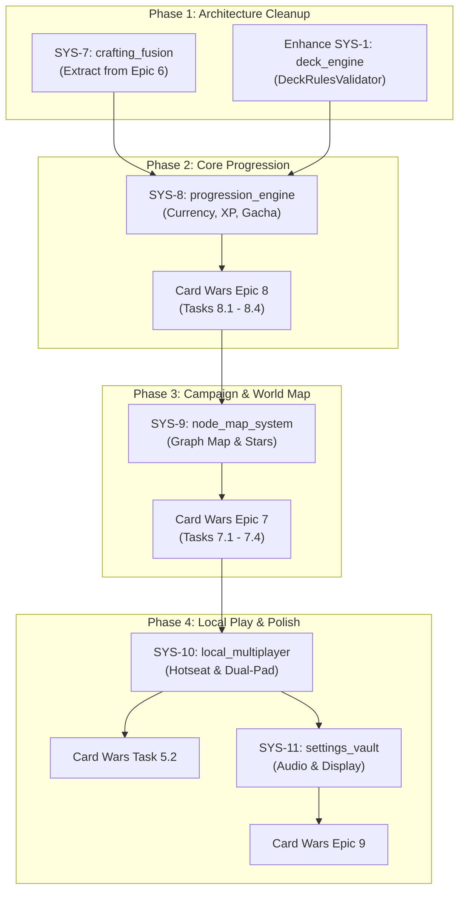

# Modular Game Systems Architecture & Catalog

This document defines the standalone, decoupled game systems in **`godot-systems-library`** (submoduled at `godot/src/systems/`), their architectural contracts, dedicated testbed scenes, and how the **Card Wars** PC remake consumes them.

---

## 🏛️ Core Architectural Directive

> **"Build systems, not monolithic games."**
> Rather than building monolithic game logic that cannot be repurposed, every core engine mechanic is constructed as an independent, extraction-ready module in `godot-systems-library`.
>
> 1. **Zero Game Coupling**: Generic systems deal strictly in abstract contracts (`CardData`, `SlotIndex`, `CurrencyBalance`, `RecipeItem`, `MapNode`) and never reference Card Wars specifics (no "Finn", "Cornfield", "db_Creatures", or hardcoded asset paths).
> 2. **Relative Preloads**: Every module uses relative paths (`preload("Component.gd")`) so it can be dropped into any Godot project.
> 3. **Dedicated Testbed Scenes (`testbed_*.tscn`)**: Every single system features an isolated, standalone runnable testbed scene to test and demonstrate its mechanics without running the full game.
> 4. **Card Wars as Composition**: Card Wars is strictly a composition consumer layer (`godot/src/`) that feeds game blueprints, art assets, and audio into these generic systems.

---

## 📦 Systems Catalog

| System ID | Directory (`godot/src/systems/`) | Module Name | Status | Card Wars Epics | Isolated Testbed |
| :--- | :--- | :--- | :---: | :--- | :--- |
| **SYS-1** | `deck_engine/` | Universal Deck & Hand Engine | ✅ Production | Epic 1, Epic 2, Epic 6 | `testbed_deck.tscn` |
| **SYS-2** | `board_system/` | Lane & Grid Board Matrix | ✅ Production | Epic 1, Epic 2 | `testbed_board.tscn` |
| **SYS-3** | `timing_wheel/` | Roulette / Timing Minigame | ✅ Production | Epic 2 (Combat) | `testbed_wheel.tscn` |
| **SYS-4** | `ability_engine/` | Trigger / Action Event Bus | ✅ Production | Epic 3 (Abilities) | `testbed_abilities.tscn` |
| **SYS-5** | `save_vault/` | Secure Atomic JSON Serializer | ✅ Production | Save system | `testbed_save.tscn` |
| **SYS-6** | `audio_jukebox/` | BGM Crossfader & SFX Pool | ✅ Production | Epic 4, Epic 9 | `testbed_audio.tscn` |
| **SYS-7** | `crafting_fusion/` | Universal Crafting & Quality Engine | 🛠️ In Progress | Epic 6 (Task 6.2) | `testbed_crafting.tscn` |
| **SYS-8** | `progression_engine/` | Economy Wallet, XP & Gacha Roller | 📋 Planned | Epic 8 (Tasks 8.1–8.4) | `testbed_progression.tscn` |
| **SYS-9** | `node_map_system/` | Directed Graph Campaign Map | 📋 Planned | Epic 7 (Tasks 7.1–7.4) | `testbed_nodemap.tscn` |
| **SYS-10** | `local_multiplayer/` | Hotseat Pass & Play / Dual Gamepad | 📋 Planned | Epic 5 (Task 5.2) | `testbed_local_multiplayer.tscn` |
| **SYS-11** | `settings_vault/` | Audio Bus, Display & Keybind Manager | 📋 Planned | Epic 9 (Task 9.1) | `testbed_settings.tscn` |
| **SYS-12** | `gamepad_navigator/` | UI Focus Graph & Virtual D-Pad | 📋 Planned (Later) | Epic 5 (Task 5.1) | `testbed_gamepad.tscn` |

---

## 🔧 Detailed Specifications: New & Retrofit Systems

### SYS-7: Universal Crafting & Quality Engine (`crafting_fusion/`)
* **Purpose**: General-purpose recipe matcher, multi-tier quality scaling, and ingredient ledger.
* **Core Classes**:
  * `CraftingRecipe`: Resource defining inputs (item IDs + quantities), outputs, currency costs, and tier prerequisites.
  * `CraftingEngine`: Validates inventories against recipes, consumes ingredients, and executes crafting.
  * `QualityScaler`: Configurable stat/visual multiplier curves for upgraded quality tiers (e.g. Standard `1.0x`, Quality 1 `1.10x`, Quality 2 `1.25x`).
* **Testbed**: `testbed_crafting.tscn` — Interactive crafting bench with ingredient slots, recipe picker, and real-time output preview.
* **Card Wars Integration**: `FusionEngine.gd` imports `CraftingEngine`, populating recipes from `db_Fusion.json` and applying Gold/Obsidian shader materials.
* **Retrofit Task**: Extract generic recipe validation and quality scaling logic from `godot/src/cards/FusionEngine.gd` and `DeckValidator.gd` into `crafting_fusion/` and `deck_engine/DeckRulesValidator.gd`.

---

### SYS-8: Progression & Economy Engine (`progression_engine/`)
* **Purpose**: Multi-currency transactions, XP curves, level thresholds, and weighted drop-table rollers.
* **Core Classes**:
  * `CurrencyWallet`: Multi-currency ledger (Soft coins, Hard gems, Energy/Stamina timer recharge). Atomic debits/credits, overflow protection, persistence signals (`balance_changed(id, old_val, new_val)`).
  * `ProgressionTracker`: Universal XP curve manager. Customizable polynomial/exponential curves, level caps (e.g. 1–50), stat point scaling bonuses, and milestone unlock signals (`level_up(entity_id, new_level)`).
  * `GachaRoller`: Universal weighted drop-table engine with rarity tiers, pity counter thresholds, duplicate compensation rules, and seed verification.
* **Testbed**: `testbed_progression.tscn` — Interactive UI with wallet deposit/spend controls, XP grant sliders with level-up animations, and a 100-pull loot box simulator with live drop rate telemetry.
* **Card Wars Integration**: Feeds Coins & Gems into user profiles, maps Hero ranks (Finn, Jake, BMO) to `db_RankUp.json`, and drives chest openings with `db_GachaWeights.json`.

---

### SYS-9: Campaign Node Map System (`node_map_system/`)
* **Purpose**: Directed acyclic graph (DAG) progression map, procedural connection lines, sequential unlocking, and 3-star objective evaluation.
* **Core Classes**:
  * `NodeMapGraph`: Graph data structure representing nodes, branch dependencies (Node B requires Node A completed), locked/unlocked/cleared states, and metadata storage.
  * `NodeMapRenderer`: Visual component that draws procedural spline/road connection lines between nodes, animates unlock reveals, and places node interactive pins.
  * `StarConditionEvaluator`: Evaluates match outcomes against generic objective criteria (e.g. `WinMatch`, `TurnLimit(max_turns)`, `HealthAbove(pct)`, `Restriction(rule)`).
* **Testbed**: `testbed_nodemap.tscn` — Interactive branching world map demo with sequential unlocking, road drawing, and star objective testing.
* **Card Wars Integration**: Loads 346 quest nodes from `db_Quest.json`, overlays nodes onto the Land of Ooo world texture, and launches battles with quest-specific enemy decks.

---

### SYS-10: Local 2-Player Multiplayer (`local_multiplayer/`)
* **Purpose**: Turn-based hotseat pass-and-play transitions with privacy blinds, plus dual-gamepad input arbitration for shared-screen play.
* **Core Classes**:
  * `HotseatCurtain`: Turn transition state machine (`TurnActive` $\to$ `CurtainActive` $\to$ `AwaitingUnveil` $\to$ `TurnRevealed`). Obfuscates private hand information during device handoff between players.
  * `PlayerInputRouter`: Dispatches hardware events (`device_id` / joypad index 0 vs 1, keyboard split) to virtual player slots. Enforces input isolation so inactive players cannot manipulate UI during an active player's turn.
  * `MatchRulesConfig`: Configuration resource defining match format (Hotseat Pass & Play vs. Dual Gamepad Shared-Screen), turn timers, and player loadouts.
* **Testbed**: `testbed_local_multiplayer.tscn` — 2-player hand simulation demonstrating the hotseat privacy curtain, turn handoff countdown/confirmations, and multi-gamepad device routing.
* **Card Wars Integration**: Powers Task 5.2 (1v1 local matches on PC / Steam Deck with custom deck selection for P1 and P2).

---

### SYS-11: Settings Vault (`settings_vault/`)
* **Purpose**: Decoupled audio bus volume synchronization, display resolution/modes, VSync, and input rebinding persistence.
* **Core Classes**:
  * `SettingsManager`: Automatically links UI sliders to Godot audio buses (`Master`, `BGM`, `SFX`), controls window display modes (`Fullscreen`, `Windowed`, `ExclusiveFullscreen`), VSync toggles, and UI scale settings.
  * `ConfigSerializer`: Reads and writes user preferences to an isolated JSON config (`user://settings.json`) with safe defaults.
* **Testbed**: `testbed_settings.tscn` — Self-contained settings screen with audio test tone generators, display switcher, and reset to defaults.
* **Card Wars Integration**: Connects pause menu and main menu options directly to `SettingsManager`.

---

### SYS-12: Gamepad Navigator (`gamepad_navigator/`)
* **Purpose**: Universal UI focus navigation graph, virtual D-pad cursor snapping, and dynamic controller button prompt decorators.
* **Core Classes**:
  * `FocusGraph`: Automatically links focus neighbors for grid/list UI elements, remembers last-focused element per modal, and handles focus trapping inside active dialogs.
  * `InputGlyphDecorator`: Swaps UI action prompts dynamically based on active device (Keyboard/Mouse keys $\leftrightarrow$ Xbox / PlayStation / Steam Deck icons).
* **Testbed**: `testbed_gamepad.tscn` — Complex nested UI with modal overlays navigated strictly via gamepad / keyboard arrows without a mouse cursor.
* **Card Wars Integration**: Powers Task 5.1 (Gamepad & Steam Deck full navigation support).

---

## 📅 System Execution Roadmap

